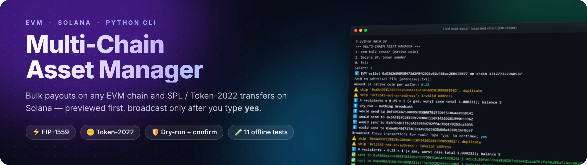
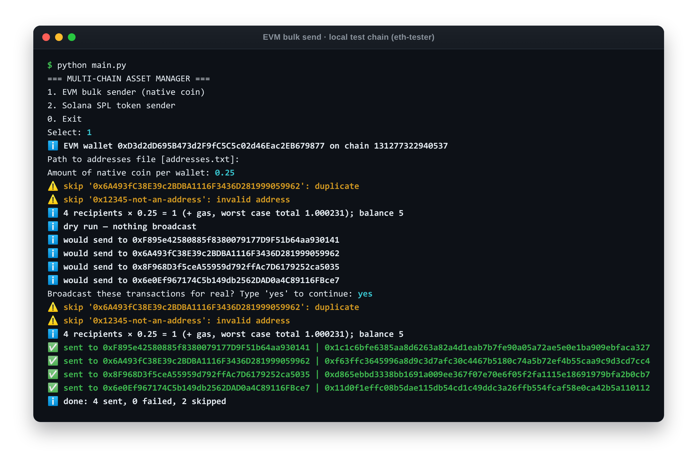
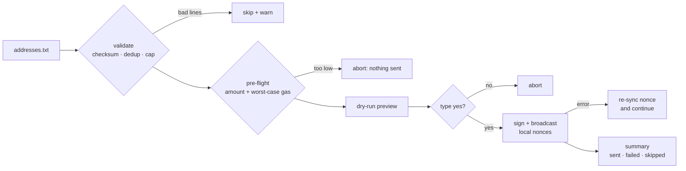
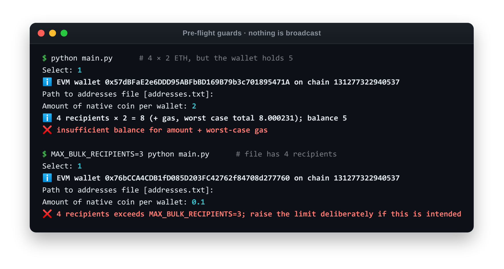
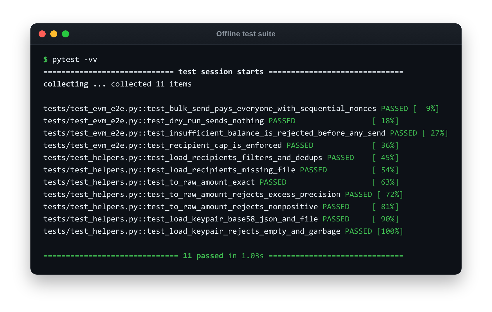

<div align="center">



<br><br>

[](#-install)
[](https://web3py.readthedocs.io/)
[](https://github.com/michaelhly/solana-py)
[](#-tests)
[](#-how-a-send-works)

**[Features](#-features) · [How a send works](#-how-a-send-works) · [Install](#-install) · [Configure](#-configure) · [Usage](#-usage) · [Tests](#-tests)**

</div>

---

A small command-line tool for moving **your own** assets on two blockchain families:

- **EVM** (Polygon, Ethereum, BSC, Base, or any EVM chain): send the same amount of the native coin to a list of addresses, such as payroll, rewards, or airdrops to your own users.
- **Solana**: send an SPL token (classic Token and **Token-2022**) to one recipient.

Every send is **previewed first**. The tool validates input, checks balances and gas, and shows what would happen. Nothing is broadcast until you type `yes`.

<p align="center">
  
  <br>
  <sub>A real session on an in-memory EVM chain (<code>eth-tester</code>). Bad lines are skipped, the batch is previewed, and nothing is broadcast until you type <b>yes</b>.</sub>
</p>

## ✨ Features

<table>
<tr>
<th width="50%">🟣 EVM bulk sender</th>
<th width="50%">🟢 Solana SPL sender</th>
</tr>
<tr valign="top">
<td>

- ⚡ **EIP-1559 fees** (`maxFeePerGas` / `maxPriorityFeePerGas`), with automatic fallback to legacy `gasPrice`
- 🔗 **POA chains** (Polygon, BSC) through `ExtraDataToPOAMiddleware`
- 🔢 **Local nonce management** starting from the `pending` count, so reruns don't collide. A failed send re-syncs the nonce, so later transactions don't stall behind a gap.
- 💰 **Pre-flight balance check** of `amount + worst-case gas` for the whole batch, *before* anything is sent
- 🧹 **Address hygiene**: checksums, skips invalid lines and duplicates, and supports `#` comments
- 🧱 **Safety cap**: `MAX_BULK_RECIPIENTS` (default 500)
- 🎯 **Exact amounts** with `Decimal`, so 0.1 really means 0.1

</td>
<td>

- 🧾 Modern **versioned (v0) transactions** built with `solders`
- 🔍 **Decimals and token program are read from the mint**, so you type `1.5`, not raw units
- 🪙 **Token-2022** mints are detected and handled automatically
- 🏦 Creates the recipient's **associated token account** if it's missing (idempotent, so it's safe to repeat)
- ✅ Checks your token balance first, then waits for **confirmation** within the blockhash validity window
- 🔑 Keys as base58, a JSON byte array, or a keypair file path

</td>
</tr>
</table>

## 🧭 How a send works



### 🛡️ Guard rails

The checks stop a bad batch **before the first transaction**, not halfway through:

<p align="center">
  
</p>

## 📦 Install

Requires **Python 3.10+**.

```bash
python -m venv .venv
source .venv/bin/activate          # Windows: .venv\Scripts\activate
pip install -r requirements.txt
```

## ⚙️ Configure

Secrets come from environment variables or a local `.env` file. They are **never** written in code.

```bash
cp .env.example .env
# then edit .env
```

| Variable | Meaning |
|---|---|
| `EVM_RPC` | EVM RPC URL (default: Polygon public RPC) |
| `EVM_PRIVATE_KEY` | Hex private key of the paying wallet |
| `SOL_RPC` | Solana RPC URL (default: mainnet-beta) |
| `SOL_PRIVATE_KEY` | Base58 secret, a JSON byte array `[..]`, or a path to a keypair file such as `~/.config/solana/id.json` |
| `MAX_BULK_RECIPIENTS` | Hard cap on recipients per bulk run (default 500) |

`.env`, keypair files, and `addresses.txt` are git-ignored.

> [!IMPORTANT]
> Use a dedicated hot wallet that holds only what you plan to send. Don't put a main wallet's key on a machine you don't fully trust. Public RPCs are rate-limited, so use your own endpoint (Alchemy, Infura, Helius, QuickNode, …) for large batches.

## 🚀 Usage

```bash
python main.py
```

**EVM bulk send:** prepare `addresses.txt` with one address per line:

```text
# team payouts
0x52908400098527886E0F7030069857D2E4169EE7
0xde709f2102306220921060314715629080e2fb77
```

Choose `1`, enter the amount per wallet, review the preview, and type `yes`.

**Solana:** choose `2`, then enter the recipient wallet, the token mint, and a human amount (for example `1.5`).

> [!TIP]
> Try everything on a testnet first, such as Polygon Amoy or Solana devnet, by pointing `EVM_RPC` / `SOL_RPC` at it.
> For compact logs like in the screenshots, set `LOGURU_FORMAT='{level.icon} <level>{message}</level>'`.

## 🧪 Tests

```bash
pip install -r requirements-dev.txt "eth-tester[py-evm]"
pytest
```

The suite works fully offline:
- unit tests for address parsing, amount conversion, and key loading;
- **end-to-end bulk-send tests on an in-memory EVM chain** (`eth-tester`), covering real signing, sequential nonces, received balances, dry runs, the insufficient-balance guard, and the recipient cap.

<p align="center">
  
</p>

## 🗂 Project structure

```text
├── main.py             # Interactive CLI (preview → confirm → send)
├── config.py           # Env/.env configuration, no hard-coded secrets
├── modules/
│   ├── evm.py          # EVM bulk sender
│   └── solana.py       # Solana SPL sender
├── tests/              # Offline unit + EVM end-to-end tests
├── docs/assets/        # README images
├── .env.example
└── requirements.txt
```

<details>
<summary><b>📝 Changelog: 2026 modernization</b></summary>

<br>

- **Fixed:** `config.py` had a syntax error (`[1, 2, 3...]`), so the app couldn't start.
- **Fixed:** `signed_tx.rawTransaction` → `raw_transaction` (renamed in web3.py v7+, which crashed every EVM send).
- **Fixed:** the Solana module imported `solana.transaction` and the sync `solana.rpc.api.Client`, both **removed** in current solana-py. It's now rewritten on `AsyncClient` with `solders` v0 transactions.
- **Fixed:** Solana sends failed when the recipient had no token account. It's now created idempotently.
- **Fixed:** raw-unit and decimals were typed by hand, which risked 1000× errors. They're now read from the mint.
- **Fixed:** `float` amounts caused rounding errors. Amounts now use `Decimal`.
- **Fixed:** a failed send left a nonce gap that stalled every later transaction. The nonce now re-syncs.
- **Added:** EIP-1559 fees, POA middleware, preview + confirmation, balance pre-check, dedup, recipient cap, and Token-2022 support.
- **Security:** private keys moved from source to env / `.env` (git-ignored).
- **Tests:** the project had none. It now has 11 tests, including EVM end-to-end tests.
- Pinned dependency ranges.
- **Fixed:** `requirements-dev.txt` was missing `base58`, so the test suite failed on a fresh install.

</details>
